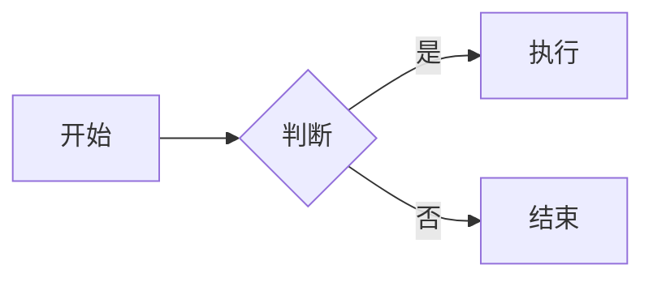

# AGENTS.md

本文件是本仓库（Hugo + `hugo-focus` 主题）的写作与协作规范。目标：让文章在现有主题下获得稳定、可复现的渲染效果，同时保证构建、SEO、可维护性。

> 原则：只使用本文件中“已验证”的语法；遇到主题文档与本文件冲突时，以本文件和实际模板代码为准。

---

## 0. 项目与命令（程序规范）

站点结构：

- `content/zh/`：正文内容根目录，文章统一放在 `content/zh/posts/<板块>/`。
- `config/_default/`：默认配置；`config/production/`：生产覆盖配置。
- `themes/hugo-focus/`：主题（git submodule），非必要不要修改。
- `static/`：原样发布的静态资源；`assets/` 由 Hugo Pipes 处理。
- `public/`：构建产物，禁止手改。
- `scripts/`：辅助脚本，入口通过根目录 `Makefile`。

常用命令：

| 目的 | 命令 | 说明 |
| :--- | :--- | :--- |
| 新建文章 | `make new` | 交互式创建；自动识别目录、翻译文件名、推荐标签，创建后用 `open` 打开文件 |
| 编辑文章 | `make edit Q="slug/标题片段"` | 按 slug、完整标题或部分标题匹配并打开 `index.md` |
| 本地预览 | `make run` | 开发服务器（包含草稿） |
| 开发预览 | `make dev` | 监听 `0.0.0.0:1313` |
| 生产构建 | `make build` | 输出到 `public/` |
| 安全校验构建 | `hugo --quiet -d /tmp/hugo-check` | 不污染 `public/`，交付前优先用它 |
| 下载文章图片 | `make img MD=content/zh/posts/tech/foo/index.md` | 下载网络图片并替换为本地路径 |
| 图片命名 | `make img MD=... SLUG=my-article` | 以文章 slug 作为文件名前缀 |
| 火山翻译 | `make translate TXT="你好"` | zh -> en（火山引擎），用于文章英文文件名 |
| 部署 | `make deploy` | 备份 + 构建 + 推送；不要擅自执行 |
| 检查 | `make check` | 依赖与健康检查 |

协作约定：

1. 新增文章优先 `make new`，不要手写错 front matter。
2. 交付前必须至少做一次构建校验：`hugo --quiet -d /tmp/hugo-check`（或 `make build`）。
3. 不要修改 `public/`、`.venv/`、`resources/_gen/` 等生成物。
4. 不要修改 `themes/hugo-focus/`，除非任务明确要求改主题；该目录是独立 submodule。
5. 不要提交密钥、Cookie、Token；腾讯云/火山引擎密钥只通过环境变量使用。
6. 不要主动 `git commit` / `git push` / `make deploy`，除非用户明确要求。
7. 正文允许原生 HTML（`unsafe = true`），但只用于本文件列出的必要效果，不要堆砌 `<style>`/`<script>`。

---

## 1. 文章文件规范

### 1.1 路径与命名

```
content/zh/posts/<板块>/<slug>/index.md
content/zh/posts/<板块>/<slug>/images/<filename>.png
```

- 新文章统一使用 Page Bundle：文章目录名就是 URL 中的 `:filename`。
- 板块目录固定为 10 类：`tech`（技术）、`programming`（编程）、`marketing`（商业）、`design`（设计）、`engineering`（工程）、`science`（科学）、`life`（生活）、`notes`（笔记）、`media`（媒体）、`other`（其他）。
- 目录名使用英文、数字、连字符：`how-to-use-hugo`。
- 避免空格、中文目录名、特殊符号。中文目录名会导致 URL 被百分号编码，影响传播与分享。
- 文章 URL 由 `[permalinks] posts = "/post/:year/:month/:filename/"` 决定，**目录名就是 URL 的一部分**。发布后不要随意改目录名；必须改时用 `aliases` 保留旧链接。
- 图片放文章目录的 `images/` 下，正文写 ``；不要写 `./images/` 或 `/assets/...`。站点文章已全部迁移为 Page Bundle，不要再新增单文件 `<slug>.md`。

### 1.2 新建流程

```bash
make new
# 依次输入：标题 -> 摘要 -> 分类 -> 目录 -> 文件名 -> 标签 -> 完整配置
```

`make new` 会：

- 扫描 `content/zh/posts/*/_index.md` 自动识别板块目录，分类展示使用文章数最多的 10 个，其他目录可从“更多目录”进入；
- 在 `content/zh/posts/<板块>/<slug>/` 下生成 `index.md`（Page Bundle）；
- 调用 Hugo archetype 生成完整 front matter；
- 使用火山引擎 `TranslateText` 把中文标题翻译成英文，并转为蛇形命名作为默认文件名；密钥缺失或翻译失败时回退为可手动修改的文件名；
- 根据标题自动推荐已有标签，也可自行输入；
- 写入 `categories`、`tags`、`series`、`weight`、`description`、`summary`、`keywords`、`cover`、`image`、`images`、`toc`、`comments`、`showShare`、`codeRunners`、`aliases`、`draft`；
- 创建完成后用 `open` 自动打开文章文件（`NO_OPEN=1` 可关闭）。

已有文章可直接按 slug 或标题片段打开：

```bash
make edit Q="tcp_ip"
make edit Q="TCP/IP 协议"
make edit Q="改变我人生"
```

自动翻译需要环境变量：

```bash
export VOLCENGINE_ACCESS_KEY_ID="..."
export VOLCENGINE_SECRET_ACCESS_KEY="..."
# 可选：export VOLCENGINE_REGION="cn-north-1"
```

交互输入已改为标准 `input()`，支持正常退格、中文输入和粘贴；不再使用原始 TTY 模式。

---

## 2. Front matter 配置规范

统一使用 TOML 分隔符 `+++`。YAML（`---`）可用，但新文章不要混用。

### 2.1 最小模板

```toml
+++
title = '文章标题'
date = 2026-01-01T10:00:00+08:00
draft = false
author = "simons"
categories = ["技术"]
tags = ["Hugo", "写作"]
description = "一句话说明本文解决什么问题、面向谁、读完能得到什么。"
+++
```

### 2.2 完整模板

```toml
+++
title = '文章标题'
date = 2026-01-01T10:00:00+08:00
lastmod = 2026-02-01T10:00:00+08:00
draft = false
author = "simons"

# 分类与标签
categories = ["技术"]
tags = ["Hugo", "Markdown", "写作"]
series = "Hugo 建站系列"
weight = 0

# 摘要与 SEO
description = "文章摘要，用于列表卡片和分享卡片。"
summary = "可选的精确摘要，用于 <meta name=\"description\"> 和摘要回退。"
keywords = ["Hugo", "Markdown"]
cover = "https://example.com/cover.jpg"
image = "https://example.com/cover.jpg"
images = ["https://example.com/cover.jpg"]

# 页面功能
toc = true
comments = true
showShare = true
codeRunners = false

# 可选
slug = "custom-slug"
aliases = ["/post/old-path/"]
+++
```

### 2.3 字段效果（以当前主题代码为准）

| 字段 | 类型 | 实际效果 | 建议 |
| :--- | :--- | :--- | :--- |
| `title` | string | 页面 H1、列表标题、浏览器标题 | 具体、可检索，避免标题党 |
| `date` | datetime | 排序、URL 年月、显示时间 | 带时区 `+08:00` |
| `lastmod` | datetime | sitemap / 更新时间 | 有实质修改时更新 |
| `draft` | boolean | `true` 时生产构建不输出 | 未完成保持 `true` |
| `author` | string | 文章署名 | 默认 `simons` |
| `categories` | string[] | 分类、列表徽标 | 1 个主分类 |
| `tags` | string[] | 标签、推荐阅读、搜索 | 2–5 个，复用已有标签 |
| `series` | string | 系列归类 | 多篇连载时使用 |
| `weight` | int | `> 0` 进入首页“精选文章”，并影响列表排序 | 少用，按顺序给正整数 |
| `description` | string | 列表卡片摘要、分享卡片描述 | 必填，80–160 字，纯文本 |
| `summary` | string | Hugo `.Summary`，影响 `<meta name="description">` | 需要精确 meta 描述时设置 |
| `keywords` | string[] | 专题页展示 | 可选，不是 meta keywords |
| `cover` | string | 首页/列表紧凑卡片、分享卡片封面 | 建议 1200×630 的绝对 URL |
| `image` | string | 精选大卡片（`weight > 0`）封面 | 精选文章建议与 `cover` 同值 |
| `images` | string[] | 分享卡片封面回退 | 可选，写绝对 URL |
| `toc` | boolean | `false` 关闭右侧目录 | 短文章可关 |
| `comments` | boolean | `false` 关闭 Giscus 评论 | 通知/声明类页面可关 |
| `showShare` | boolean | `false` 关闭分享按钮 | 一般保留 |
| `codeRunners` | boolean | 为受支持语言的代码块添加“运行”按钮 | 含可运行代码时开启 |
| `math` | boolean | 当前主题全局已开启 KaTeX；`math = false` 不能关闭 | 不用配置 |
| `slug` | string | 当前 permalink 使用 `:filename`，`slug` 不改变本文 URL | 用文件名控制 URL |
| `aliases` | string[] | 旧链接 301/跳转页 | 改文件名后必须补 |

补充：

- 主题的 `<meta name="description">` 读取的是 `.Summary`，不是 `description`。因此：
  - 想让列表/分享卡片好看：写 `description`；
  - 想精确控制搜索引擎摘要：再写 `summary`，或保证正文第一段就是有效摘要。
- `showToc`、`showAuthor`、`showReadingTime`、`autoCollapseToc` 等字段在当前主题中**未被读取**，不要依赖它们实现功能。
- 标签请先用 `make new` 的自动补全，避免出现 `JS` / `JavaScript` / `js` 三份。

---

## 3. 正文写作规范

### 3.1 结构

- 页面标题由 front matter 的 `title` 生成，正文不要再写一级标题。
- 正文从 `##` 开始；需要三级、四级用 `###`、`####`。目录（TOC）采集 1–4 级标题。
- 开头 1–3 段说明：背景、问题、结论或阅读收益。第一段会参与自动摘要。
- 长文每 3–5 段插入小标题，避免“标题党式空章节”。
- 文末给出总结、边界条件或下一步；需要提醒风险时用提示组件。

### 3.2 文字

- 中文使用全角标点；中英文之间、数字与中文之间加一个空格，提升可读性。
- 列表用于并列项，表格用于多维对比，不要用表格写长段落。
- 强调用 `**粗体**`、`*斜体*`；删除线用 `~~删除~~`。
- 行内代码用反引号；键盘按键用 `<kbd>`；高亮用 `<mark>`；上下标用 `<sup>` / `<sub>`。
- 下划线用 `<u>文字</u>`。
- 不使用 `==高亮==`、定义列表等未启用的扩展语法。

### 3.3 链接

- 站内链接用相对路径或 Hugo 链接：`[标题](/post/2026/01/foo/)`。
- 站外链接直接写完整 URL；主题会自动加 `target="_blank"`、`rel="noopener noreferrer"` 和外链图标。
- 邮件、电话、锚点链接会自动识别并着色。
- 链接文字要可读，不要写“点击这里”。

### 3.4 图片

- 图片 alt 必须有语义，例如 ``。
- 需要特殊视觉效果时，alt 使用约定关键字（见 4.5）；此时 alt 会被当作图片说明显示。
- 不希望显示说明文字时，用原生 `` 代替 Markdown 图片。
- 网络图片建议用 `make img` 下载到本地，避免外链失效、混合内容、隐私追踪。
- 大图建议宽度 ≤ 1600px；截图优先 WebP/PNG，照片优先 WebP/JPEG。

---

## 4. Markdown 渲染能力（已验证）

### 4.1 代码块

围栏代码块必须标注语言：

````markdown
```python
print("hello")
```
````

- 语法高亮：highlight.js + monokai。
- 支持常见语言别名，如 `js`、`ts`、`py`、`cpp`、`bash`、`sh`、`yml`、`md` 等。
- 关闭行号显示；不要手写行号。
- 代码块内的 `<`、`>`、`{{` 会按代码显示，不会被模板解析。

### 4.2 可运行代码

在 front matter 设置：

```toml
codeRunners = true
```

受支持语言（以 `themes/hugo-focus/data/runners.toml` 为准）：

`python`、`rust`、`go`、`typescript`/`ts`、`javascript`/`js`、`cpp`/`c++`、`c`、`csharp`/`cs`、`java`、`lisp`、`ruby`、`swift`、`php`、`shell`/`bash`/`sh`、`lua`、`r`、`perl`、`kotlin`、`scala`、`dart`、`haskell`、`zig`、`nim` 等。

注意：

- 只有 `codeRunners = true` 时才显示“运行”按钮。
- 运行依赖外部 Playground 或 WASM 运行时，网络不可用时会失败。
- 不要把需要密钥、文件系统、私有依赖的代码放进运行按钮。

### 4.3 数学公式

使用 KaTeX，支持：

```markdown
行内：$E = mc^2$

块级：
$$
\int_{-\infty}^{\infty} e^{-x^2}\,dx = \sqrt{\pi}
$$
```

也支持 `\(...\)`、`\[...\]`。

主题内置宏（可直接用）：

| 宏 | 含义 |
| :--- | :--- |
| `\RR \NN \ZZ \QQ \CC \PP` | 实数、自然数、整数、有理数、复数、概率空间 |
| `\abs{x}` | 绝对值 |
| `\norm{x}` | 范数 |
| `\inner{a}{b}` | 内积 |
| `\set{x}` | 集合花括号 |
| `\bra{\psi}` / `\ket{\psi}` | 量子态左/右矢 |
| `\dd` | 正体微分 d |
| `\diff{f}{x}` / `\pdiff{f}{x}` | 全导数 / 偏导数 |
| `\vec{v}` / `\mat{A}` | 粗体向量 / 矩阵 |

全局已开启 KaTeX。行内公式不要过长；块级公式过宽时主题会横向滚动。

### 4.4 Mermaid 图表

````markdown

````

支持流程图、时序图、甘特图、思维导图等 Mermaid 语法。节点文字含特殊字符时用引号包裹。

### 4.5 图片样式（alt 关键字）

Markdown 图片的 alt 使用下列关键字即可套用样式：

| alt | 效果 |
| :--- | :--- |
| `circle` / `圆` | 圆形裁剪 + 边框阴影 |
| `zoom` / `缩` | 缩小到 60% |
| `shadow` / `阴影` | 圆角 + 阴影 |
| `dline` / `虚线` | 虚线边框 |
| `line` / `线` | 实线边框 |
| `rev` / `反` | 色相反转 |
| `opa` / `半透` | 50% 透明 |
| `glazing` / `gla` / `毛玻璃` | 强模糊 + 相框感 |
| `blur` | 模糊，悬停恢复 |
| `gray` | 灰度，悬停恢复彩色 |
| `zoom-shadow` / `shadow-zoom` / `圆角-阴影` / `阴影-圆角` | 缩小 + 圆角 + 阴影 |

示例：

```markdown

```

注意：Markdown 图片会被渲染成带 `<figcaption>` 的 `<figure>`，alt 关键字会作为说明文字显示。若不想要说明文字，改用：

```html

```

### 4.6 文字样式（原生 HTML）

| 写法 | 效果 |
| :--- | :--- |
| `<span style="color:red">文字</span>` | 指定颜色 |
| `<span alt="rainbow"><span>文字</span></span>` | 彩虹渐变字 |
| `<span alt="shake"><span>文字</span></span>` | 故障/抖动字 |
| `<span alt="hollow"><span>文字</span></span>` | 空心字 |
| `<span alt="blink"><span>文字</span></span>` | 闪烁字 |
| `<span alt="str"><span>文字</span></span>` | 深色代码块风格 |
| `<span alt="glow">文字</span>` | 发光字 |
| `<span alt="hide"><span>文字</span></span>` | 隐藏，悬停显示 |
| `<span style="display:none">文字</span>` | 始终隐藏（不用于关键信息） |
| `<font title="blue"><span>标签</span></font>` | 彩色小标签，支持 `red`、`blue`、`yellow`、`green`、`gray` |

不要使用旧文档里的 `<span alt="btn">`，当前主题没有对应样式。

### 4.7 提示块（blockquote alt）

```html
<blockquote alt="danger"><p>危险操作说明。</p></blockquote>
<blockquote alt="success"><p>成功或推荐做法。</p></blockquote>
<blockquote alt="warn"><p>警告信息。</p></blockquote>
<blockquote alt="question"><p>待确认的问题。</p></blockquote>
```

注意关键字是 `warn`，不是 `warning`。提示块内容建议只放 1–3 句。

不要使用 `>![INFO]` 这类 Markdown callout 语法：主题的 blockquote render hook 当前不会命中，实际不会渲染成 callout。

### 4.8 时间线

```html
<div alt="timeline">
  <div alt="timenode">
    <div alt="meta">2024.01 ~ 2024.06 <a href="#">项目一</a></div>
    <div alt="body">完成了第一阶段的开发与验证。</div>
  </div>
  <div alt="timenode">
    <div alt="meta">2024.07 ~ 2025.01 <a href="#">项目二</a></div>
    <div alt="body">上线并持续迭代。</div>
  </div>
</div>
```

适合履历、项目历程、版本演进；普通并列内容用列表即可。

### 4.9 原生 HTML 折叠

```html
<details>
  <summary>点击展开</summary>
  这里是折叠内容，支持 Markdown 之外的原始 HTML。
</details>
```

### 4.10 嵌入 iframe

```html
<iframe
  src="https://player.bilibili.com/player.html?bvid=BV1xx411c7mD"
  height="480"
  scrolling="no"
  frameborder="no"
  allowfullscreen="true">
</iframe>
```

只在必要时使用；优先给链接 + 截图。嵌入第三方内容会带来性能、隐私和可用性风险。

### 4.11 表格、任务列表、删除线

- 表格：标准 Markdown 表格，主题已加横向滚动容器。
- 任务列表：

```markdown
- [x] 已完成
- [ ] 未完成
```

- 删除线：`~~旧内容~~`。

---

## 5. 短代码（Shortcodes）速查

### 5.1 alert（推荐用于提示）

```markdown

正文支持 **Markdown**。

```

类型：`info`、`warning`、`success`、`danger`、`note`。类型可省略，默认 `info`。

### 5.2 collapse（折叠，替代 `details`）

```markdown

这里是被折叠的内容，支持 **Markdown**、列表、代码块。

```

参数：

| 参数 | 必填 | 说明 |
| :--- | :--- | :--- |
| `summary` | 是 | 摘要文字 |
| `openByDefault` | 否 | `"true"` 时默认展开 |
| `content` | 否 | 用参数直接传入内容，与内部内容二选一 |

> 重要：不要使用 ``。主题里的 `details.html` 是空模板，实际不会输出内容；请用 `` 或原生 `<details>`。

### 5.3 notice（旧式提示）

```markdown

这是一条注意事项。

```

当前样式只做红色文字提示。新文章优先用 `alert`。

### 5.4 book（书籍卡片）

```markdown

```

注意参数名是 `colection`（主题现有拼写），不是 `collection`。`rating` 为 10 分制。

### 5.5 echarts（交互图表）

```markdown

{
  title: { text: '示例图表' },
  tooltip: { trigger: 'axis' },
  xAxis: { type: 'category', data: ['A', 'B', 'C'] },
  yAxis: { type: 'value' },
  series: [{ type: 'bar', data: [12, 20, 15] }]
}

```

- 内部必须是合法的 JavaScript 对象字面量，不要写 `const option = ...`。
- 依赖 CDN 加载 ECharts；无网络时图表不可用。
- 图表要配文字结论，不要让图表单独承担信息。

### 5.6 crypto（前端密码混淆）

```markdown

这里是要隐藏的内容。

```

- 默认密码是文章 front matter 的 `title`，改标题会导致旧密码失效。
- 指定其他 front matter 字段作为密码：

```toml
+++
title = '文章标题'
password = "your-password"
+++
```

```markdown

内容

```

- 这是前端 Base64 + 校验，不是真正加密；不要放密钥、隐私数据、商业机密。

### 5.7 protected（显式密码）

```markdown
{}
这里是要隐藏的内容。
{}
```

- 使用 `%` 分隔符。
- 同样是前端保护，只适合防误读，不适合防攻击。
- 内容不要包含未转义的双引号，避免破坏 `data-content` 属性。

### 5.8 wordcloud（标签词云）

```markdown

```

无参数，自动读取站点标签生成 2D 词云。适合独立页面，不适合正文中段。

---

## 6. 视觉阅读体验建议

### 6.1 文章节奏

- 开头：1 段背景 + 1 个结论/收益提示（`alert` 或引用）。
- 主体：`##` 分节，每节 3–5 段；长代码/长日志放入 `collapse`。
- 对比：用表格；流程：用 Mermaid；数据趋势：用 ECharts。
- 结尾：总结 + 风险提示/下一步（`alert success` / `alert warning`）。

### 6.2 组件使用节制

- 同一屏不要出现超过 2 个 `alert`。
- 文字特效只用于标题、关键词或演示；正文大面积彩虹字/闪烁字会伤害阅读。
- 图片特效优先用 `shadow`、`zoom-shadow`、`line`；`blur`、`hide` 只用于交互演示。
- 时间线、词云、ECharts 属于重组件，一篇普通文章最多用 1 个。
- 折叠块用于“可选深度内容”（完整代码、附录、长日志），不要把核心结论折叠起来。

### 6.3 深色模式

- 不要在正文写死浅色背景 + 深色文字，深色模式下会不可读。
- 需要自定义颜色时优先用语义色或主题提供的文字特效。
- 图片带白色背景时，优先转成透明 PNG 或加边框（`line` / `shadow`）。

### 6.4 移动端

- 宽表格会自动横向滚动，但列数建议 ≤ 6。
- 图片宽度使用默认自适应，不要写死 `width="1200"`。
- 代码行宽尽量 ≤ 100 字符；长行在移动端需要横向滚动。
- iframe 高度不要超过一屏，避免移动端难以继续滚动。

### 6.5 封面与卡片

- `cover`：列表卡片、分享卡片，建议 1200×630，主体居中，避免小字。
- `image`：精选大卡片（`weight > 0`），建议与 `cover` 相同。
- `images`：社交分享回退图，写绝对 URL。
- 没有封面时列表会退化为纯文字卡片，可接受；不要用低质占位图。

---

## 7. SEO 规范

### 7.1 标题与摘要

- `title`：具体、可检索，包含核心名词；避免“震惊”“必看”等空词。
- `description`：80–160 字，说明“是什么、解决什么问题、适合谁”；纯文本，不写 Markdown。
- `summary`：需要精确控制 `<meta name="description">` 时设置；否则保证正文第一段可独立成摘要。
- 一个页面只表达一个主题；不要把多篇内容硬拼成一篇。

### 7.2 URL

- URL 形如 `/post/2026/01/file-name/`，由文件名决定。
- 使用英文小写 + 连字符；不要用日期、版本号堆叠。
- 发布后不要改文件名；必须改时加 `aliases`。
- 中文标题可以保留在 `title`，文件名仍建议英文。

### 7.3 结构化信息

- `categories`：每篇 1 个主分类。
- `tags`：2–5 个，覆盖主题词、技术词、场景词；复用已有标签。
- `series`：多篇连载时设置，便于聚合。
- `weight > 0`：只给真正需要首页推荐的精选文章；滥用会让首页失去层次。
- `lastmod`：有实质更新时修改；站点已开启 `enableGitInfo`，也可由 Git 提交时间提供。

### 7.4 图片与社交分享

- 每篇至少一张有信息量的图；封面图写绝对 URL。
- 社交分享图优先 `cover` / `images`；尺寸 1200×630。
- 图片 alt 写清内容；使用特效关键字时，SEO alt 会变成样式词，此时重要图片改用原生 `<figure>` + ``。

### 7.5 链接与抓取

- 站内相关文章用内链，形成主题簇。
- 外链使用稳定来源；不要链到短链、网盘临时地址。
- 站点自动生成 `sitemap.xml`、RSS、canonical、Open Graph、Twitter Card、Schema（生产环境）。
- 不要写隐藏关键词、堆砌标签、复制粘贴重复内容。
- 草稿保持 `draft = true`，避免未完成页面被收录。

### 7.6 当前 SEO 实现要点

- `<meta name="description">` 使用 `.Summary`，不是 `description`。
- Open Graph / Schema 由 Hugo 内置模板生成，读取标题、描述、`images` 等。
- 列表卡片使用 `description`，分享卡片优先 `description`，其次 `summary`，再次正文摘要。
- `keywords` 字段当前只在专题页展示，不会输出 meta keywords。

---

## 8. 专题 / 列表页配置

板块首页是 `content/zh/posts/<板块>/_index.md`。需要专题式布局时：

```toml
+++
title = "软件工具教程"
description = "专题说明，会显示在专题页顶部。"
keywords = ["工具", "教程", "效率"]
date = 2026-01-15

[cascade.params]
series = "软件工具教程与最佳实践"

[params]
listStyle = "docs"
showSummary = true
orderBy = "weight"
icon = "tools"
+++
```

说明：

- `listStyle = "docs"` 启用文档式列表；默认是 `default`。
- `showSummary = true` 显示文章摘要；否则显示紧凑列表。
- `orderBy` 支持 `weight`、`date`、`title`。
- 子文章可用 `weight` 控制顺序；`weight` 越大越靠后，`> 0` 同时会进入首页精选。
- `cascade` 可把 `series`、`comments` 等参数下发给子文章。
- 不要在 `_index.md` 里写正文式长文；专题页负责聚合与导航。

---

## 9. 图片与资源规范

### 9.1 下载网络图片

```bash
make img MD=content/zh/posts/tech/foo/index.md
```

默认行为：

- 下载到 `static/assets/post_images/`；
- Markdown 链接替换为 `/assets/post_images/<name>.<ext>`；
- 原 Markdown 会备份（脚本配置决定）。

指定前缀：

```bash
make img MD=content/zh/posts/tech/foo/index.md SLUG=my-article
```

### 9.2 存储位置

| 位置 | 用途 |
| :--- | :--- |
| Page bundle 的 `images/` | 新文章配图，推荐；自动压缩/响应式 |
| `assets/` | 全站共享图片，需模板用 `resources.Get` 查找 |
| `static/assets/post_images/` | 历史文章配图，按原样发布 |
| `static/images/` | 站点级图片、支付码、封面 |

Page bundle 示例：

```
content/zh/posts/tech/my-article/
├── index.md
└── images/
    └── diagram.png
```

在 `index.md` 中写 ``，主题会生成 480/768/1024 宽的 WebP 响应式图片；GIF 与 SVG 保留原文件，不做 WebP 转换。`./images/...` 与 `/assets/...` 也会被项目级 render hook 兼容，但新文章统一用 `images/...`。

VS Code 用 Paste Image 时，项目已提供 `.vscode/settings.json`：截图后按快捷键，图片自动落到当前文章目录的 `images/`，并插入 ``。

全站共享图片放 `assets/images/foo.png`，正文写 ``。项目级 render hook 的顺序是：Page Resource → `resources.Get` → 原样输出，因此静态 `/assets/post_images/...` 仍然兼容。

图片文件名统一为 `<文章目录名>-<原始文件名>`，例如 `web_design-2026-11-27-07-26-28.png`。Paste Image 默认只生成时间戳名，写作时用下列任一方式补齐前缀：

- 常驻 `make watch-images`：粘贴后自动重命名并修复 Markdown 链接；
- 批量执行 `make img-rename`；
- 在 VS Code 任务面板运行 `Watch pasted images` 或 `Rename pasted images`。

### 9.3 规范

- 不长期热链外部图片；发布前尽量本地化。
- 文件名用英文小写 + 连字符：`hugo-homepage.webp`。
- 截图统一宽度；避免同一篇文章混用多种截图比例。
- 不在图片里放大段文字；必要信息用正文复述。
- 不在图片 EXIF 中保留敏感位置信息（站点已对 Hugo 处理的图片关闭日期与经纬度）。

---

## 10. 交付前检查清单

- [ ] front matter 完整：`title`、`date`、`draft`、`author`、`categories`、`tags`、`description`。
- [ ] 正文从 `##` 开始，没有重复 H1。
- [ ] 代码块都有语言标注；需要运行的代码已设 `codeRunners = true`。
- [ ] 所有图片有有意义 alt；使用特效 alt 时确认说明文字可接受。
- [ ] 没有使用 ``、`>![INFO]`、`==高亮==` 等未生效语法。
- [ ] 外链可访问；站内链接路径正确。
- [ ] 没有写死深色/浅色背景，深色模式可读。
- [ ] 构建通过：`hugo --quiet -d /tmp/hugo-check`。
- [ ] 没有提交密钥、Token、隐私数据。
- [ ] SEO：标题具体、description 完整、封面 1200×630、标签复用。
- [ ] 精选/置顶（`weight > 0`）使用克制。

---

## 11. 已知限制与坑

1. `` 是空模板，不输出内容；用 `` 或原生 `<details>`。
2. `>![INFO]` 形式的 Markdown callout 不会生效；用 `` 或 `<blockquote alt="...">`。
3. 旧文档中的 `<span alt="btn">` 没有样式，不要使用。
4. 图片特效依赖 alt 关键字，alt 会作为图片说明显示；不想要说明就用原生 ``。
5. `crypto` 默认密码是文章 `title`；改标题会导致旧密码失效，且它只是前端混淆。
6. `protected` 也是前端保护，不能防抓取；敏感内容不要放正文。
7. `echarts` 依赖 CDN；离线或网络受限时图表空白。
8. `keywords` 不是 meta keywords；不要指望它直接提升搜索排名。
9. `slug` 不改变当前 permalink；URL 由文件名决定。
10. `showToc`、`showAuthor`、`showReadingTime`、`autoCollapseToc` 当前主题未读取。
11. `math = false` 无法关闭全局 KaTeX；全局已开启。
12. 中文文件名会造成 URL 编码；新文章使用英文文件名。
13. `public/` 是生成物；校验构建请输出到 `/tmp` 或使用 `make build`，不要手改 `public/`。
14. 主题位于 submodule；改动主题需单独提交到主题仓库，不要混在内容提交里。
