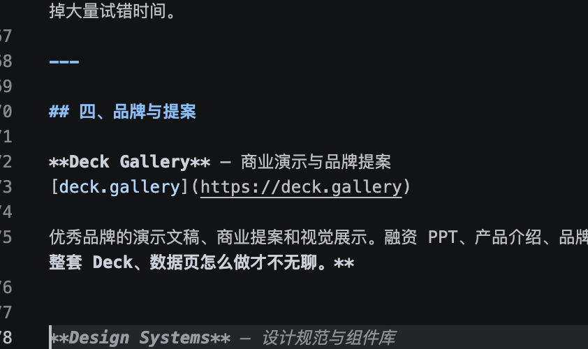

+++
title = "10 个设计灵感站，喂给 AI 做出不像模板的网站"
date = 2026-11-27T06:28:57+08:00
draft = false
author = "simons"
categories = ["技术"]
tags = ["web", "design", "AI", "跨境电商", "独立站"]
description = "10 个国外高质量设计灵感网站，覆盖落地页、定价页、广告素材、邮件营销等场景。附带一套把设计案例喂给 AI 编程工具的实操方法，告别千篇一律的模板感。"
aliases = ["/post/2026/11/web_design/"]
+++

下面这 10 个国外设计资源站，从电商落地页、广告素材、产品定价到社交媒体运营、营销邮件，基本全覆盖。每一组都标好了适用场景，直接按需取用。

## 一、页面结构与首屏

**Land-book** — 高转化落地页灵感库
[land-book.com](https://land-book.com)

大量出色的网站和 Landing Page 案例。做独立站、SaaS、电商落地页时，不知道页面怎么排、转化路径怎么走，对着它看。重点看**首屏文案怎么写、CTA 按钮摆在哪、区块之间的节奏怎么控**。

**Supahero** — 网站首屏设计灵感
[supahero.io](https://supahero.io)

专门收集优秀网站的 Hero Section，也就是访客打开页面第一眼看到的主视觉区。适合琢磨怎么靠一张图、一句话把人留住。**做 A/B 测试之前，先来这里找参考。**

**Navbar Gallery** — 导航栏设计
[navbar.gallery](https://navbar.gallery)

从极简导航到复杂 Mega Menu 都有。做独立站、企业官网、SaaS 后台时对照着选。导航看着是小细节，实际上是**用户判断「这网站靠不靠谱」的第一道关**。

**OG Image Gallery** — 链接分享封面
[ogimage.gallery](https://ogimage.gallery)

收的是网站链接预览图的设计案例。产品链接发到 X、Discord 或者社交平台时，那一张小图决定了别人点不点得进来。**容易被忽略，但做好了回报率极高。**

---

## 二、转化与信任

**Pricing Pages** — 产品定价页面案例
[pricingpages.design](https://pricingpages.design)

看优秀 SaaS 怎么拆价格套餐、摆会员权益、做付费引导。做 AI 工具或者订阅制产品的，尤其该翻一翻。**重点看它们怎么设计锚定价格、怎么引导用户选中间档。**

**Social Proof Examples** — 客户信任设计
[socialproofexamples.com](https://socialproofexamples.com)

将近 200 种社会认同的展示方式——用户评价、销量数字、客户 Logo 墙、案例背书，全在里面。**独立站最缺的就是信任感，这里能直接抄作业。**

---

## 三、营销与广告素材

**Really Good Emails** — 营销邮件案例库
[reallygoodemails.com](https://reallygoodemails.com)

大量海外品牌真实发出过的营销邮件。做跨境电商、邮件召回、促销活动，都能进去找现成参照。**按行业和场景筛选，别从头翻。**

**Adfolio** — 海外广告创意案例
[adfolio.design](https://adfolio.design)

出色的广告创意和案例集中营。做 Facebook、Instagram 广告、电商带货素材的，拿来研究**钩子怎么下、卖点怎么排、视觉怎么突出产品**。

**Posts Design** — 社交媒体视觉素材
[posts.design](https://posts.design)

按风格、配色找社交媒体帖子的设计灵感。做 Instagram、X、自媒体内容时，直接看已经跑通的视觉排版，省掉大量试错时间。

---

## 四、品牌与提案

**Deck Gallery** — 商业演示与品牌提案
[deck.gallery](https://deck.gallery)

优秀品牌的演示文稿、商业提案和视觉展示。融资 PPT、产品介绍、品牌方案都能用上。**看配色系统怎么贯穿整套 Deck、数据页怎么做才不无聊。**

