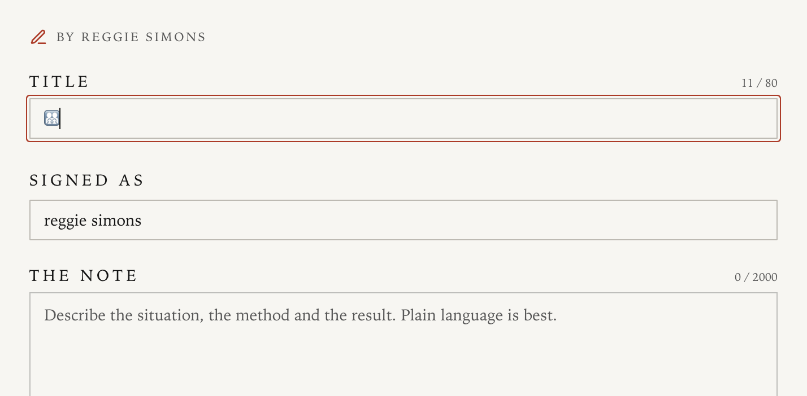
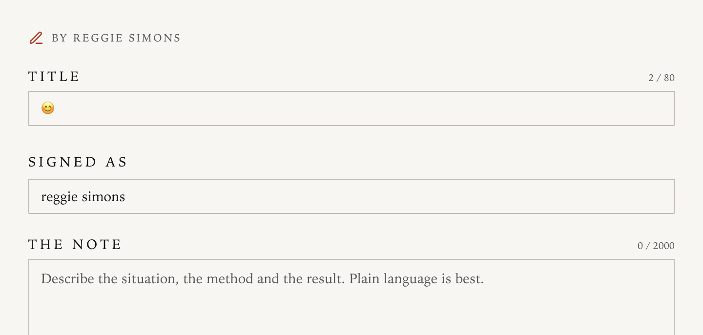
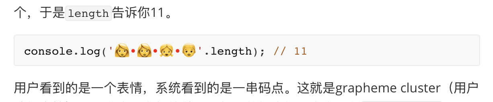

+++
title = "表情符号差异：emoji 的历史"
date = 2026-11-24T08:16:23+08:00
draft = false
author = "simons"
categories = ["人文"]
tags = ["emoji","Unicode"]
description = "从一个字符数异常的Bug出发，追问Emoji为何诞生于日本、如何被Unicode收编，以及标准化之后谁仍在解释和拥有这些符号。"
codeRunners = true
aliases = ["/post/2026/11/way_emoji_from_jp/"]
+++

今天遇到一个 BUG，在一个新项目里输入“👩‍👩‍👧‍👦”（家庭表情），系统显示它有11个字符：



输入“😊”（笑），系统则显示2个字符：



过去我以为每个表情的字符数应该都是固定的，为什么会出现这种差异？

顺着这个问题往下查，会碰到Unicode码点、UTF-16代理对、ZWJ组合序列，也会碰到一段更早的历史：Emoji并不是某个硅谷巨头凭空发明的“现代产品”，而是一段由资费、硬件限制、商业竞争和标准妥协共同推着走出来的通信演进史。要理解今天的一个表情为什么“长度是11”，得先理解它当年为什么会被发明出来。

本文参考了这篇文章：https://mp.weixin.qq.com/s/TyVxvHtTyDjmR2L8IXZCdw?poc_token=HKbWBGuj1UdcgPDWruQ188UJ1udCjmrHUMe9vkIq

## 一个表情，为什么不是一个“字符”？

在系统底层，Emoji首先是字符，是一组被编码、被传输、被渲染的码点，图片只是最后的显示结果。开发者习惯用`string.length`去量一个表情，得到的往往不是1。

```js
console.log('😊'.length); // 2
```

比如“😊”在UTF-16里占2个代码单元，因为它的码点U+1F60A位于补充平面，需要用代理对表示。家庭表情“👩‍👩‍👧‍👦”更极端，它不是一个码点，而是“女人+ZWJ+女人+ZWJ+女孩+ZWJ+男孩”的组合序列，我在 markdown 编辑器 Typora 里输入这个表情，它显示如下：



> ZWJ（Zero Width Joiner，零宽连字符U+200D）是Unicode里的一种控制字符，用于组合两个字符，使它们看起来像一个字符。

四个表情码点加三个零宽连字符U+200D，共7个Unicode码点。其中四个表情码点各占2个UTF-16代码单元，三个ZWJ各占1个，于是`length`告诉你11。

```js
console.log('👩‍👩‍👧‍👦'.length); // 11
```

用户看到的是一个表情，系统看到的是一串码点。这就是grapheme cluster（用户感知字符）和码点序列之间的差距。如果数据库给用户名限制`VARCHAR(10)`，用户把这个家庭表情填进名字，系统就可能报截断错误甚至崩溃。把图形变成字符，看似优雅地解决了统一编码，却也把这种复杂性留给了今天的软件工程师。

但更大的问题是：为什么偏偏是日本，在1999年前后，把情绪做成了字符？

## 要回答“为什么是日本”，先看当时的通信资费

很多人会从日本的漫画文化、可爱文化（Kawaii）或表达含蓄去解释 Emoji 的起源。但如果从工程和通信的角度看，答案要具体得多。

1990年代中期，日本的 PHS（个人手持电话系统，可以理解为中国后来“小灵通”的前身）非常流行。


1995 年，日本电信公司 Pocket Bells 推出面向年轻人的寻呼机，在键盘里内置了一个很小的符号——“♥”。


这个爱心在今天看来平平无奇，当时却引发了现象级传播。高中生用寻呼机发文本，按键繁琐、费用也贵，一个爱心既能省下好几个字的空间，又能精准传达情绪。

它其实是一种极简的表达压缩：在昂贵的通信管道里，用最少的字符塞进最多的语气。

后来 Pocket Bells 推出新版寻呼机，以为年轻人更想要字母和复杂功能，把“♥”删掉了，结果大量年轻用户迅速流失，转投竞争对手。这件事给日本移动通信界留下了一个很深的印象：在移动通信里，非文本的图形符号不只是装饰，它有商业价值，也有用户黏性。

到了1999年，日本移动运营商 NTT DoCoMo 准备推出 i-mode。


i-mode 是世界上最早的移动互联网雏形之一，用户可以在简陋的黑白屏或早期彩屏手机上看天气、查新闻、发邮件。

但当时的硬件限制非常残酷：内存以KB计，屏幕像素很低，资费还按数据包计算，邮件字数上限也很紧。多写几个字，用户要付的钱就直线上升。

参与 i-mode 开发的栗田穣崇发现了一个文化层面的矛盾。日本书信文化讲究客套和礼貌，纸质信件开篇要问候天气，结尾要有敬语。但在手机屏幕上，如果为了省钱把这些全删掉，只留下“今天晚饭吃什么？”这样干瘪的一句话，接收者会觉得冷漠、生硬。


如何在极短的字符限制里，把语气、上下文和情绪一次性塞进去？栗田穣崇想到用12×12像素的网格画图，绘制了第一批176个图标，包括天气、心形、星座、交通工具和简单脸部表情。


这些图标就是“絵文字”的起点。日语里“絵”是图画，“文字”是字符。Emoji从一开始就不是单纯的“图片”，而是一种为了在极度匮乏的数据管道里传递情绪而发明的“压缩算法”。

## 三家运营商，为什么把表情做成了“乱码”？

NTT DoCoMo的Emoji推出后迅速打爆市场。竞争对手KDDI和SoftBank看在眼里，急在心里：既然DoCoMo有表情，那我们也必须有。于是三家运营商很快各自推出了自己的Emoji字符集。


问题也在这里埋下。三家运营商在设计Emoji时，并没有坐下来商量统一的编码标准。当时的计算机字符集，无论是ASCII还是日本常用的Shift-JIS，都有一块未被官方定义的空白区域，叫Private Use Area，简称PUA，私有保留区。

标准组织的意思很明确：这块区域留给公司内部自己玩，比如自定义公司Logo字体，但不要传到公网上去。

三家日本运营商却直接把各自的Emoji塞进了Shift-JIS的PUA区域。DoCoMo的“马”在编码0xF97B，KDDI的“马”在0xE5A3，SoftBank的“马”在0xF68B。更麻烦的是，不仅编码不一致，连含义都对不上：DoCoMo里某个编码代表“开心”，到了SoftBank相同编码区，可能映射成“一把枪”或“一顶帽子”。

可以把PUA理解成小区内部的楼栋编号：在各自小区里能用，一旦跨小区寄快递，编号就撞车了。于是日本移动通信史上出现了著名的“表情乱码危机”：DoCoMo用户给SoftBank用户发一封带表情的邮件，接收方按自己家的映射表渲染，你本想发“甜品”，对方手机上可能弹出一座“墓碑”。

到2000年代中期，日本移动互联网已经很发达，但三家运营商为了几百个小图标，在后台维护了极其庞大且恶心的映射转化表。用户跨网发短信，邮件网关就要查硬编码规则，做一次“字符翻译”。这种私有协议冷战如果一直留在日本本土，Emoji也许永远只是日本移动通信史上的局部特产。

## 苹果和谷歌，为什么最终把Emoji送进Unicode？

转折来自两个硅谷巨头准备进入日本市场。

2007年，苹果发布第一代iPhone。2008年，Steve Jobs带着iPhone进军日本，与软银达成独家合作。软银CEO孙正义给乔布斯提了一个很硬的要求：iPhone想在日本卖得动，必须支持Emoji；不支持，日本年轻人根本不会买单。

乔布斯起初对这件事完全不感兴趣。对一个崇尚工业设计和干净排版的硅谷公司来说，这些来自日本运营商的粗糙小图案，简直是字符集的异端。但市场是残酷的，苹果最终妥协。

iOS 2.2版本里，苹果专门针对日本市场的iPhone秘密内置了一套Emoji键盘，并直接采用SoftBank的私有PUA编码。这意味着，一个美国用户拿到日本版iPhone也找不到这个键盘；就算通过改配置文件把表情发给普通电脑，对方看到的也只是未知空白方框。

几乎同时，谷歌也在把Android推向全球，并想拿下日本市场。当时在谷歌工作的Mark Davis和Yasuo Kida做了一个决定：不能再这样修修补补。如果不想让全世界的通信接口被几百个私有符号搞崩溃，就必须把Emoji正式引入Unicode标准。

2007年，谷歌和苹果联合向Unicode联盟提交了一份长达几十页的提案，申请将日本Emoji纳入Unicode全球通用字符集。这份提案在Unicode委员会内部引发激烈争议。Unicode的初衷是“为世界上每一种语言的每一个字符提供统一数字编码”，本质是语言学和字形学，收录的是汉字、希腊字母、阿拉伯文、梵文。

许多保守派专家认为：Unicode是用来传承人类文明和书面语言的，怎么能把“💩”“🍣”这种商业公司搞出来的低俗小玩意，和世界上最古老的文字放进同一张编码表？

但提案者提出了一个无法反驳的工程事实：Emoji在日本已经被数千万人使用了十几年，它已经是现实中真实存在的数据流。如果不把它标准化，全世界的软件工程师就要在自己的代码里写一辈子私有映射表。

Unicode最终向现实低头。2010年，Unicode 6.0发布，正式收录1000多个Emoji字符。从此，Emoji摆脱了“日本运营商私有扩展”的身份，变成和字母A、汉字“国”平起平坐的全球通用一等公民字符。

今天你在任何手机上敲下一个Emoji，底层都是一个全局唯一的Unicode码点，比如“💩”就是U+1F4A9。

## 为什么今天的键盘里还有花牌、城堡和土下座？

打开iPhone或Android键盘，翻到表情页，仍会看到“🎴”花牌、“🏯”日本城堡、“🍢”关东煮、“🎍”门松、“♨️”温泉、“🙇”土下座。这些带有极强日本地域色彩的符号，为什么会堂而皇之出现在一个面向全球几十亿人的通用字符集里？

原因仍在刚才那条历史线索里。Unicode收录Emoji时，为保证向前兼容，遵循了一个冷酷的工程原则：**必须无缝兼容1999年日本三家运营商已经存在的所有历史符号**。哪怕有些符号在欧美或亚洲其他国家看来莫名其妙，为了不破坏日本用户存下的旧邮件和旧数据库，Unicode选择原封不动地全盘接纳。这是软件工程里典型的“历史包袱变成全球标准”。

## 标准化之后，Emoji就中立了吗？

Unicode统一了码点，但没有统一字形，也没有统一解释。

Emoji进入全球标准之后，新的问题随之出现：谁有权决定一个符号长什么样、代表什么、能不能用？

新增一个Emoji并不由某家公司说了算。提案需要提交正式文件，说明为什么这个符号值得进入全球字符集、符合哪些选拔标准，然后经过Unicode委员会多轮审核。提案被拒绝是常态。

2024年，德国巴伐利亚州数字化部正式提交“巴伐利亚狮子”的Emoji申请，最终被驳回，且Unicode没有给出解释。奥地利邮政申请“邮递员”Emoji，同样被拒。更值得注意的是一组关于月经用品的提案——卫生棉条、卫生巾、月经杯，三项全部被拒绝。

谁的需求更容易被这套流程接纳，谁的需求更容易被过滤掉，本身就是一个社会权力问题。

Unicode统一了码点，但没有统一字形；字形归平台，平台归公司。

苹果对自家Emoji设计主张版权，开发者可以在App内使用系统渲染的Apple Emoji，但不能在其他平台使用这些设计，也不能将Apple Emoji字体直接嵌入应用二进制文件。

世界Emoji日定在7月17日，原因也与此有关：苹果日历Emoji上的日期，来自2002年7月17日iCal在Macworld大会上的发布日期。一个全球性的“符号节日”，落点是一个公司产品的发布纪念日——这或许是Emoji历史最简洁的隐喻：它从标准中来，但它的肉身始终长在平台的商业逻辑里。

解释权同样分散。2017年以色列的一起租房纠纷中，租客给房东发了一串表情：“早上好我们想要租这间房 👩✌☄️现在只需要讨论细节了”，房东据此把房子从市场上撤下，结果租客租了别处。

法官判定这串表情——笑脸、跳舞的女人、香槟——传达了“极大的乐观态度”，足以让房东合理认为对方承诺了租房，判租客赔偿约2200美元。几年后租客解释，那些表情只是随手在备选框里选的，☄️是因为她是生态工作者，那是她最常用的符号。

德国的一起案件则展示了Emoji如何反过来“加重”罪责：两名员工在聊天中用两个动物表情指代两位主管，被控侮辱，他们辩解“这不是猴，是熊”，但其中一位主管的外号恰好就是“熊”，法官最终以“熊脸”进行法律考量。

中国的司法数据也显示，2018年以来全国以表情符号作为证据的案件共158起，从2018年的8件增至2020年的66件、2021年的61件。但不同法院对同一表情的认定并不一致：广州中院在一起仓储合同纠纷中认为“👌”只是辅助表达情绪的可视化图像，不能认定为法律意义上的承诺；厦门中院在民间借贷纠纷中则认为，根据语境，“👌”应视为同意。

一个符号是否构成“同意”，至今没有统一答案。

视觉政治也没有消失。

2016年之后，苹果率先将手枪Emoji从写实的左轮手枪改为荧光绿色的水枪，随后谷歌、微软、三星等平台陆续跟进。

官方解释通常围绕“减少暴力联想”或“平台设计更新”，但批评者指出，把符号从“枪”改成“水枪”，并不改变“🔫”在文本中的语义位置——一个人仍然可以打出“🔫🔫🔫”来威胁他人，视觉上的去武器化更多是平台的一种姿态。

肤色modifier的引入则是另一个方向。

2014年之前，人脸Emoji默认是白人面孔；在“Diversify my Emoji”等民间运动的压力下，苹果和谷歌工程师参与修订提案，2015年iOS和OS X更新中加入了六种肤色选项。

这是Emoji标准第一次被社会运动实质性推动的“多元化”修订，但它也暴露了原有默认值的政治性：当“人脸”默认是白的时，非白人面孔是“添加的选项”；当肤色成为可调节的“修饰符”时，种族被编码成了一种可选参数，而不是默认的多样性。

甚至“统一码点”也不等于“统一字形”。Unicode在最初描述某些Emoji时，用点阵阴影来表示颜色深浅。谷歌的Emoji设计师把“❤️”描述中的阴影点阵理解成了“毛发”，于是在早期Android上，一颗普通的心被渲染成了“长毛的心”。

码点统一了，从码点到字形之间仍然存在一个解释环节，而解释权在平台手里。

## 11个字符的Bug

从1995年寻呼机上的那枚“♥”，到今天需要复杂渲染引擎和状态机解析的组合Emoji，这条线并不只是“日本可爱文化走向世界”的故事。

它更像一次层层推导：通信资费压缩了表达空间，表达需求催生了图形字符，商业竞争把字符塞进私有编码，私有编码的混乱又逼着苹果、谷歌和Unicode把Emoji收编为全球标准，而标准化为了兼容历史，又把日本的地域符号和工程复杂性一起留了下来。

也不难理解 Emoji 的起源：全球通用字符的起点，曾经只是为了在昂贵的通信管道里，省下几个字，又不想显得太冷漠。